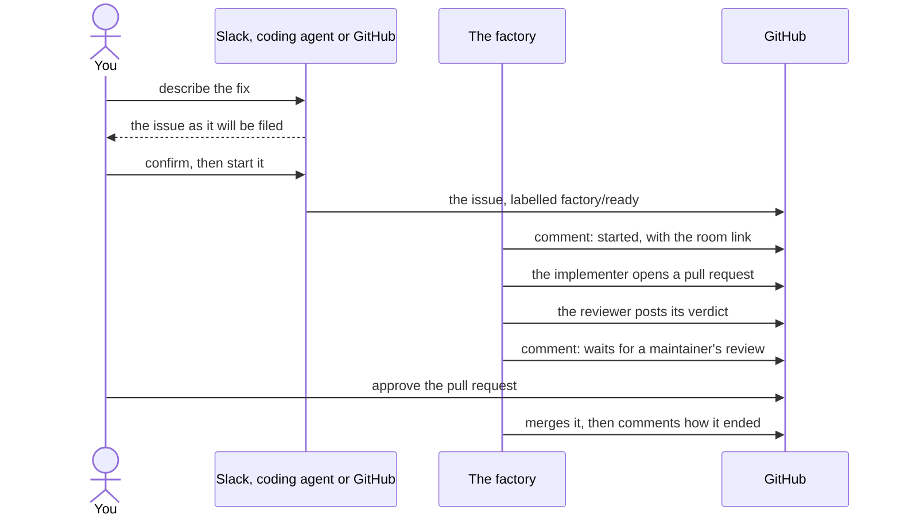

By the end of this chapter you will have handed the factory one small fix and merged its pull request. Pick the path that matches where you work; all three end at the same pull request.

| You are in | Path | You need |
|---|---|---|
| A Slack conversation | [Slack](#paths) | Your Slack user linked, a channel the app serves |
| Your coding agent (Claude Code, OpenCode, Codex…) | [Coding agent](#paths) | `maku` installed and set up for your agent |
| GitHub | [GitHub issue](#paths) | Maintainer rights on the repository |

Your five minutes are the request and the review. The agents' work in between takes ten to twenty minutes, and you do not have to watch.



## Pick your path {#paths}




**1. Link your Slack user, once.** Mention `@factory link` in a channel the app serves. Open the private one-time link, sign in, verify your Slack user and GitHub login, and press **Link**.

**2. Ask in your own words.** Mention `@factory` with what is wrong, what it should be, and the file path:

```text
@factory docs/install.md links to quickstart-old.md, which does not exist.
It should link to quickstart.md.
```

**3. Read the proposal.** Within seconds the app posts one plan message in the thread showing the repository, exact **Issue** body, workflow (`standard`), roles (`implementer, reviewer`), ceiling (`$5.10`), and **Confirm / Cancel** buttons.

Check the **Issue** section first: the agents read nothing else, and the planner copies your words without checking the repository ([chapter 4]()).

**4. Edit by replying.** Reply in the thread to revise the plan (for example `the acceptance check should also verify no other page links to the old name`). The proposal updates in place with `‹changed›` markers.

**5. Confirm.** A maintainer clicks **Confirm** or reacts ✅. The app files the issue and posts the room URL:

```text
Filed #N for @you, sponsored by GitHub @your-login; the factory starts it.
Room: https://rooms.example/r/<room>
```

**6. Follow in the thread.** The thread posts `Triaged.`, `Pull request #… opened.`, and `The work waits for a human (…)`. Reply `status`, `needs me`, or `the pull request` anytime; thread replies do not steer the agent.

**7. Approve on GitHub.** Review and approve the pull request. The merger merges the approved commit within a minute and the thread posts `#… merged.`

Every Slack message and refusal: [Use › Slack]().




**1. Set up, once.** Install `maku` ([chapter 8]()), then connect it to your coding agent:

```bash
maku setup claude      # or opencode, codex, gemini, cursor, copilot
maku doctor            # every line should read ok
```

**2. Hand off a side task.** When you spot a bug mid-session, tell your agent:

```text
/maku handoff test-storage-dashboard.py finds no dashboard when the
repo is checked out under .claude/: it matches SKIP against the absolute path
```

**3. Read the plan.** `handoff` stores the plan on the broker and shows the drafted issue, workflow, and budget:

```markdown
ci(tests): test-storage-dashboard finds no dashboard under .claude/

## What is wrong
scripts/ci/tests/test-storage-dashboard.py:35 matches SKIP against the
absolute path, so checkouts under `.claude/` find 0 dashboards.

## What it should be
Match SKIP against the path relative to the repository root.

## Acceptance check
Running the test from a `.claude/worktrees/t` worktree and from a normal
checkout both exit 0.
```

**4. Confirm and start.** Your agent calls `start`, which re-validates the plan and opens a confirmation form (**File: yes**, **Start now: yes**). `maku` files the issue with your `gh` credentials and applies `factory/ready`. Clients without form support receive a copyable `gh issue create` command instead; your agent never starts a task on its own.

**5. Let your agent follow it.** `wait` runs in the background while you keep working and wakes when the task needs you, opens a pull request, or ends:

```markdown
### gmmrmund · #2759 ci(tests): test-storage-dashboard finds no dashboard …
**needs you** · waiting for a human · owner/repo
[open the room](https://rooms.example/r/gmmrmund)

| Run | reviewer · succeeded |
| Spend | $0.16 of $5.10 (3 %) |
| PR | #2760 · reviewer approved |
```

**6. Try the branch locally (optional).** Run `maku checkout gmmrmund` (or `room_checkout`) to inspect the branch in a clean worktree beside your checkout.

**7. Approve on GitHub.** Read the diff and reviewer verdict, then approve. The factory merges and posts what it spent (`Spent: $0.16 (433 k tokens)`).




**1. Write the issue.** One defect, three sections ([chapter 4]()):

```markdown
docs: the logging page lists the wrong chart version

## What is wrong
docs/observability/logs.md says version 0.13.9. The repository pins 0.13.10.

## What it should be
The page says 0.13.10, the version the repository pins.

## Acceptance check
- docs/observability/logs.md names 0.13.10.
- No other page names 0.13.9 for this chart.
```

**2. Label it `factory/ready`.** Only a maintainer's label counts, and the factory snapshots the issue at that moment.

**3. Follow the factory's comments.** Within a minute it narrates the run, budget, room URL, pull request, reviewer start, and hand-off:

```text
Agent factory task `gmmrmund` started run `tabl4eue` (implementer) on branch `agent/gmmrmund`.
- Budget: 1.5 M tokens, 45 minutes (tier standard)
- Watch: https://rooms.example/r/gmmrmund
- Stop: apply the label `factory/stop`

Run `tabl4eue` opened #2760. Reviewer run `sitjutqz` started.
Task `gmmrmund` waits for a maintainer's review. Approve this pull request to merge.
```

Open the **Watch** link to inspect live steps in the room ([chapter 5]()).

**4. Read the reviewer's verdict.** The reviewer posts one advisory comment (`Agent review: approved` or changes requested) naming the commit it checked.

**5. Review and approve.** Use **Request changes** to trigger a revision run on the same branch, or **Approve** once no run is active. The merger merges the approved head and closes the task with total spend.




## What just happened {#agents-work}

Whichever path you took, the factory ran five steps:

1. **Snapshotted the issue** when labelled (later edits require re-applying `factory/ready`).
2. **Triaged the task** into a workflow and budget tier ([chapter 4]()).
3. **Ran the implementer** on `agent/<task>` against your acceptance check and CI.
4. **Ran the reviewer** to check the pull request and post its verdict.
5. **Handed off to you** for final approval and merge.

## You review {#you-review}

Review the pull request on GitHub as you would a colleague's. Its body ends with **Try it**: the `maku checkout` line that puts the branch in a new worktree beside yours, and the room's link.

- **Request changes:** the factory launches a revision run on the same branch using your review comments.
- **Approve:** wait until the room shows no active run so your approval lands on the exact head ([chapter 7]()).

If the merge bot cannot merge, it comments the reason and [chapter 7]() explains what to do.

**Next:** [chapter 4]() shows how to write requests the agents finish on the first try.
