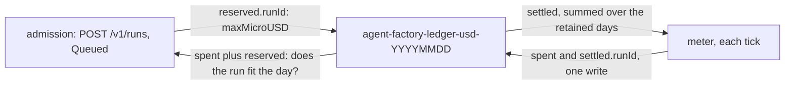
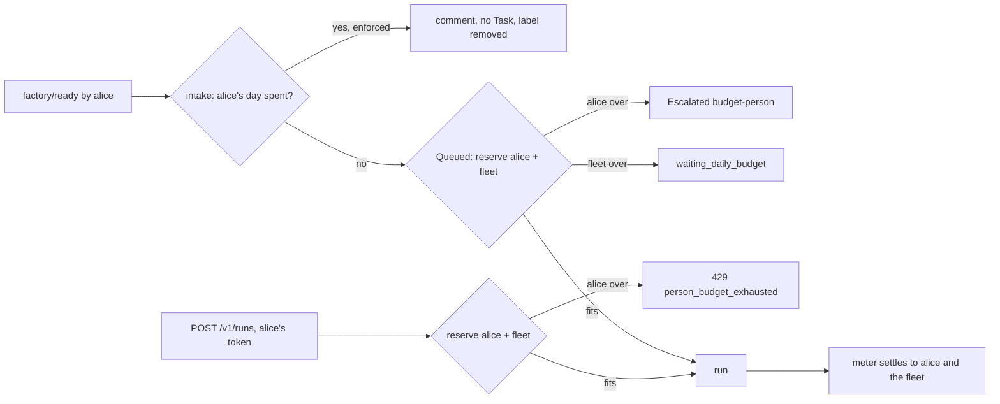

## Pricing, tiers and meter queries

The run meter revokes a run at its run cap (`budget-run`). Before every run, the task cap must still hold one whole run, except for a reviewer, which needs a quarter of a run's tokens left and starts capped at what remains (at most a whole run), so the task never passes `taskTokens`. The overlap evaluation's scoper run is recorded in the task's usage but not counted against its caps. If the cap holds no such run, the task escalates as `budget-task` when `budgets.enforceTask` is set (the default), and is only counted when it is not. A run lost to its sandbox is resumed only within the cap, whatever `enforceTask` says.

With `meter.prices` set, both caps are also in USD, so a cache read costs its own rate rather than a full input token. The token caps keep binding beside them: the meter revokes a run at its `runTokens` and no run starts without `runTokens` left of the task's `taskTokens`, whatever the dollars say, because a flat-rate model's nominal prices leave the USD caps out of reach. A tier that omits `runUSD` or `taskUSD` then caps at its token cap counted at $1.70 per million: the `standard` tier's 1.5 M and 3 M tokens become $2.55 and $5.10. Without prices both caps stay in tokens.

| Setting | Effect |
|---|---|
| `meter.prices.<model>: {input, cacheRead, cacheWrite?, output, source?, checkedAt?}` | USD per million tokens, keyed by the model that served the tokens (`glm-5.3`, `claude-opus-5-5`) when `meter.query` groups by `gen_ai_request_model`, else by the tier's logical model. `cacheWrite` defaults to `input`. Each price must be positive. `source` (an `https://` URL) and `checkedAt` (`YYYY-MM-DD`) say where and when the row was read: checked when set, never priced |
| `tiers.<tier>.runUSD`, `tiers.<tier>.taskUSD` | The tier's caps in USD; `taskUSD` may not be below `runUSD`. Keyed by logical model, a tier with either set and no price for its model fails the rollout: an unpriced run would cost $0 |
| `meter.query` | Must group by `gen_ai_token_type` (`input`, `cached_input`, `cache_creation_input`, `output`; agentgateway's own `input_cache_read` and `input_cache_write` read as the two cache types, so a scrape need not relabel them), or no run can be priced and every run is capped in tokens. Grouped by `gen_ai_request_model` too, each model is priced at its own rate. Should keep the gateway replica apart, in a `by (...)` clause naming `pod` (or `instance`): the meter then keeps one baseline per returned series, so a replica whose scrape drops out for a tick adds nothing and, on its return, only what it grew, and a replica's counter that falls restarted and adds its new value. A query summing the replicas loads with a startup warning and keeps the per-run reading: a stale replica's return charges its counter again (an over-count that can revoke a run under budget), and a replica restart loses that tick's growth, until the query keeps `pod` |

Grouping by served model is what makes a logical name safe to price: the same claim's `agent-default` is GLM-5.3 on one gateway listener and Claude Opus on another, about ten times dearer. A run's cost is the sum over the models that served it of `(input − cached_input − cache_creation_input) × input + cached_input × cacheRead + cache_creation_input × cacheWrite + output × output`, divided by 10⁶; a series without `gen_ai_request_model` is priced by the claim's logical model.

On [maku-gateway](), the meter reads agentgateway's own series, with no relabel. The gateway labels each with `ar_agent`, the caller's verified token subject, which for a portable run is its ServiceAccount, named like the run:

```
sum by (ar_agent, gen_ai_request_model, gen_ai_token_type, pod) (agentgateway_gen_ai_client_token_usage_sum{ar_agent=~"system:serviceaccount:<runs ns>:<namePrefix>.+"})
```

A scrape that renames them (ai-native-ref's `vmpodscrape.yaml`) uses `gen_ai_client_token_usage_sum` instead. Its 429s come from the same place, through `meter.throttle.promQuery`:

```
sum by (ar_agent) (increase(agentgateway_requests_total{status="429", reason="RateLimit", ar_agent=~"system:serviceaccount:<runs ns>:<namePrefix>.+"}[2m])) > 0
```

A series above zero names its run as throttled. Like VictoriaLogs' rows, a run is read only from the verified `ar_agent`, and a failed lookup costs only that tick's fleet mapping. Keep `reason="RateLimit"`: the counter also counts a provider's 429s passed through, and a throttled run is revoked as `budget-fleet` ([the gateway]()).

Every gateway path the platform runs counts the cache tokens inside `input`: agentgateway 1.6's Chat Completions to Messages translation, streamed or not, and Z.ai's `prompt_tokens`. A model whose `input` is below `cached_input + cache_creation_input` comes from a gateway that leaves them out: it is priced with all of `input` as fresh, and `maku_factory_meter_input_excludes_cache_runs_total{model}` counts the run. A run served by a model with no price is never $0: it is held to its token caps, and `maku_factory_meter_unpriced_model_runs_total{model}` names the model.

At GLM-5.3's prices ($1.40 / $0.26 / $4.40):

- **Run cap.** Implementer runs of 1.54–1.69 M tokens cost $0.58–0.70, well under $2.55. The same volume with no cache hit costs $2.30–2.49, so the cap stops an uncached run near 1.8 M tokens.
- **Task cap.** A `pair` task of 4.7 M tokens at 95 % cache reads costs $1.78 of its $5.10. Uncached, the same task costs $6.77.

A task falls back to `taskTokens` while any of its runs is unpriced (`runs[].unpriced`) or has tokens and no cost: a cost is never counted as $0. The gateway's per-run bucket (B1, 5 M) charges a priced call its price in reference tokens, from the same `meter.prices`, and an unpriced one its raw tokens; the meter names a gateway 429 `budget-run` (`gateway-ceiling`) when the run's spend in that unit reaches 5 M, and `budget-fleet` below it. The metrics for each cap are in [Operations]().

## Daily budgets

The fleet's day (`budgets.factoryDailyUSD`, $42.50) and each human's (`budgets.humanDailyUSD`, $8.50) are in USD: 25 M and 5 M tokens at $1.70 per million, with a cache read counted at its own rate. A file that still writes the token days (`budgets.factoryDaily`, `budgets.humanDaily`, `budgets.perPerson.dailyTokens`) loads in this release: each is ignored and named in a startup warning with the key to use, and the next release refuses it.

One ConfigMap per UTC day, `agent-factory-ledger-usd-<YYYYMMDD>`, holds the days in micro-USD:

| Key | Holds | Written by |
|---|---|---|
| `spent` | Principal → micro-USD charged that day | The meter |
| `reserved.<runId>` | `{principal, person?, room?, maxMicroUSD}`, dropped when the run ends | Admission |
| `settled.<runId>` | The micro-USD charged to that run that day, in the same write as `spent`; on the first day a run taken as already charged at the switch (below) is next charged, it also holds that spend (a run whose early days were pruned is lifted the same way), which `spent` never counts | The meter |



Admission refuses (enforced) or counts (shadow) a run whose reservation does not fit beside the day's spend and reservations: a task run reserves its `runUSD`, or its `runTokens` at $1.70 per million on a tier capped in tokens, and a `POST /v1/runs` its `maxTokens` at $1.70 per million.

Each tick the meter charges a run's priced increase, or its token increase at $1.70 per million when the run cannot be priced (never $0), to every key the run is charged to and to its `settled.<runId>`, in one write. A meter that first sees a run, a new leader included, reads what the ledgers settled for it and starts it there. A write that reports an error may have landed all the same: the next tick reads that day's `settled.<runId>` to learn how much did, and charges only the rest. A write judged lost can still commit later, a 504 that commits after the next tick read the ledger back: the meter keeps the run's entry as that read saw it and reads it again on each attempt of its own write, taking any gain off what it adds. A new leader does the same against the entries it learned, for a write its predecessor lost. That write carries the ledger's new `resourceVersion`, so a late one conflicts; across midnight the meter first updates the failed write's ledger to the same end, and a new leader does so for the days its first read of the run showed, today's, and, in the first ten minutes of a day, the day before ([#166](https://github.com/Smana/maku/issues/166)). A run is charged once across a failover, a ledger that cannot be read, a failed write, landed or not, and midnight, with five bounded exceptions:

- A gateway counter reset before a new leader's first reading, once the counters have passed what was settled, loses what the run spent before the reset: an under-count.
- A run whose served model loses its price after such a reset and failover is charged its tokens at $1.70 per million on top of what was settled: an over-count.
- A lifted run's late spend not yet in a ledger at a failover (the leader's write was lost, or it died before its next tick) is not charged: an under-count bounded by the reading lag at a run's end.
- On a per-replica query, a new leader whose first reading of a run misses a stale gateway replica counts that replica's whole counter when it returns: it cannot tell a returning replica from a new one on a run it has never read. An over-count bounded by that replica's share of the run.
- On a summed query, a gateway replica that is stale for a tick is charged its whole counter again when it returns, and a replica's restart loses that tick's growth: an over-count that can revoke a run under budget (H-4), and an under-count. Only a `meter.query` that keeps `pod` fixes it.

The meter deletes the ledgers after 35 days, and the token ledgers `agent-factory-ledger-<YYYYMMDD>` they replaced the same way. A run the meter first sees ended, with its usage annotated, is taken as charged for what it has spent so far when nothing is settled for it, or when it began before the oldest retained ledger: that spend was charged in the token ledgers, or partly in a day since deleted. The meter keeps that amount pending and writes it into the run's `settled.<runId>` with the run's next charge, so a new leader after a failover does not charge it again. Only that first sighting is judged so: what the run's later readings add is charged. So the day of the switch to USD starts at $0: runs that ended before it are not charged again, and runs in flight are charged their whole cost.

## Per-person caps

Off by default (`budgets.perPerson.enabled: false`): every run is admitted exactly as before. On, each run is charged to the person who caused it **and** to the fleet (`system:factory`), in one ledger entry, so no run holds one reservation without the other.

| Run | Charged to |
|---|---|
| A labelled task's first run and its automatic follow-ups | The labeller, `github:<login>` |
| A task's runs after a `/factory retry` | The maintainer who typed it (`status.retriedBy`) |
| `POST /v1/runs` by a human | Their GitHub login through their [GitHub account link](); with no link, their own `human:<sub>` |
| A schedule's or RunLore's task, a system caller's API run | The fleet alone, as before |

Each run record keeps its person in `status.runs[].chargedTo`, and the claim in `agents.ogenki.io/charged-to`: the meter settles the run's cost to the fleet and to that person, never to the token's `human:<sub>`, so one person has one ledger key whichever path they use. Logins are lowercased.



| Setting | Effect |
|---|---|
| `budgets.perPerson.enabled` | Charge the person beside the fleet. Alone it only counts: a run past a person's day is admitted and counted as `budget-principal-shadow{principal}` |
| `budgets.perPerson.dailyUSD` | Every person's day, in USD. Default: `humanDailyUSD` |
| `budgets.enforcePrincipal` | With `enabled`, refuse: intake comments and drops the label, Queued escalates `budget-person`, the API answers `429 person_budget_exhausted`, and the meter revokes a live run once its person's day is spent (`budget-principal`). The fleet's day keeps its wait |

The person's day is in USD, like the fleet's ([Daily budgets](#daily-budgets)). Turning it on: set `enabled` and watch `budget-principal-shadow{principal}` for a week, then set `enforcePrincipal`.
