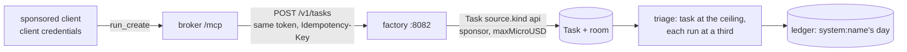
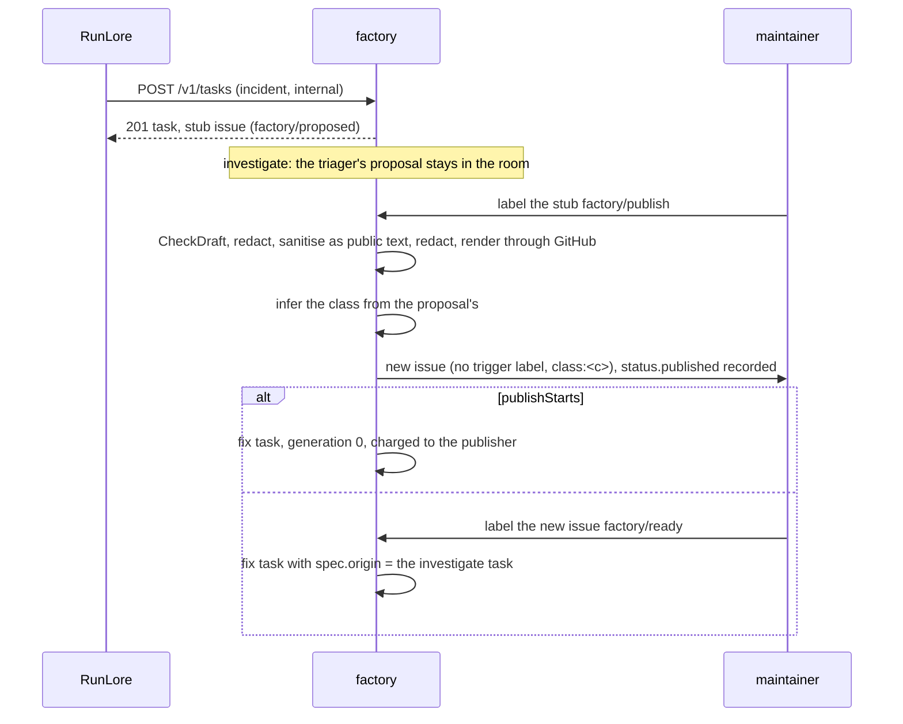

Off by default: with no `api.sponsored`, `POST /v1/tasks` is `404` and the broker lists no
`run_create`. A machine starts factory work only as a **sponsored principal**: a machine client
at your identity provider that the config binds to a maintainer, with a day in dollars and a ceiling on every request.
Its request becomes a `Task` of `spec.source.kind: api`, which triage, the gate and narration then
treat as any other. Source: `internal/factory/api/tasks.go`.

`api.sponsored` is a list; each entry holds:

| Key | Holds |
|---|---|
| `name` | A DNS label. The principal is `system:<name>`, the ledger key and `requestedBy`. Never `factory`, `runlore`, `scheduler`, `room-broker` or `policy`, nor a name in `api.systemPrincipals`; unique |
| `clientIDFile` | The file holding the principal's client id, read at each use (the host's sync rewrites it when ids change). It must name a **machine (client-credentials) client**: every subject of that client becomes `system:<name>`, so a client with human subjects would admit them all as the principal. Unique across entries, and never the web UI's or `maku`'s client |
| `sponsor` | A GitHub login, the maintainer accountable for the principal. It must be in `maintainers` of every repository in `repositories` |
| `repositories` | The listed repositories the principal may use, spelled as listed; at least one |
| `dailyUSD` | The principal's day, in (0, `budgets.factoryDailyUSD`] |
| `maxCostUSD` | The largest `max_cost` one request may ask for, in (0, `dailyUSD`] |
| `maxOpenTasks` | How many of its tasks may be open at once. Default 3. A **soft cap**: it is counted before the Task is created, so a burst of N concurrent distinct requests can open up to cap+N-1 tasks |
| `onBehalfOf.slack` | `{"<team id>/<user id>": <maintainer login>}`: a request naming `slack:<team>/<user>` is sponsored by that maintainer instead. An unknown user is `not_linked`, a login outside `maintainers` is `not_a_maintainer` |
| `onBehalfOf.slackLinks` | `true`: a Slack user `onBehalfOf.slack` does not list is looked up in the broker's [self-serve link]() records (`GET /v1/links/slack` on `:8443`, as `system:factory`). The link names an account at your identity provider, never a login: the factory resolves the account's **current** GitHub login through `api.access`, then holds it to `maintainers` as any sponsor. No link, an inactive account or no GitHub link is `not_linked`; a lookup that fails is `503 link_unverified`. **The config wins**: a user listed in `onBehalfOf.slack` is never looked up. Needs `api.access`; refused on an internal principal |

Whenever `api.sponsored` is set, the client's token must carry the install's audience, or the token
is refused: `api.audience` or `api.audienceFile` under `preset: generic`.

**Preset: ZITADEL** ([identity]())

The audience is the project: `api.projectIDFile` names the file holding the ZITADEL project id, and
it is required whenever `api.sponsored` is set.

`api.sponsored` also needs `meter.prices`: a ceiling in dollars is meaningless on unpriced runs, and
without prices the intake answers `503 meter_unpriced`. The chart mounts the files from
`sponsoredSecret` ([chart](https://github.com/Smana/maku/blob/main/charts/maku-factory/README.md)). Config load checks every row above
and admission checks the sponsor again.

**The request.** `max_cost` is mandatory, in USD: at least $0.01, at most the principal's
`maxCostUSD` and at most the largest `taskUSD` among the tiers. It is stored as `spec.maxMicroUSD`,
which the CRD makes immutable. Class, tier, template, auto-merge and egress are never the caller's:
unknown fields are refused, and `dataClass` is `public` only. The sponsor and `onBehalfOf` come from
the config and the link map, never from the caller. [The endpoint]()
lists the refusals.

**The ceiling's split.** Triage caps the task at `min(tier taskUSD, max_cost)` and each run at a
third of `max_cost` (`min(tier runUSD, max_cost / 3)`), the meter holding each run to its own cap.
Tokens follow at the reference rate ($1.70 per million), so a run that cannot be priced keeps a
ceiling too.

**An api task is never split.** The scoper offers no split to a task with a ceiling: its children
would each carry their own and escape it.

**A titled task waits for its issue.** The factory detects a titled api task by its text starting with
`# `, and waits up to 2 minutes for the issue the intake files just after creating the Task. An
untitled text that itself starts with `# ` is mistaken for one and waits the same 2 minutes before
it proceeds. Known; nothing is lost but the wait.

**Who pays.** An api task's runs are charged to `system:<name>` beside the fleet, whether
`budgets.perPerson` is on or off, and the principal's day is `dailyUSD`. A maintainer's
`/factory retry` moves the payer to the retrier, as for any task: they pay as the retrier, with
their own day. With per-person caps off (`budgets.perPerson`), a retried api task's runs are
charged to the fleet only: nobody's day applies, but the task's ceiling still holds.

**What bounds the day.** The intake checks the principal's day (spent plus reserved, plus the
request's whole `max_cost`) and answers `429 principal_budget_exhausted`, but that check is
**advisory**: nothing is reserved at intake. The hard limit is the run-time reservation under
`system:<name>`, which is enforced whatever `budgets.enforcePrincipal` says, together with each
run's ceiling/3 cap held by the meter. A later run refused for the day escalates the Task
(`budget-person`), possibly with a pull request already open.

**If a principal leaves the config.** Its live runs are no longer held to its day (the day comes
from the declaration), and a task that needs a new run escalates `principal_unknown`. Remove a
principal only once its tasks have ended.

**The issue.** With a `title`, the factory files the issue itself with the factory App (no label: the
Task exists already), the body ending with a footer naming the sponsor and the principal;
`spec.issueAuthor` is the sponsor. Without a `title` the Task has no issue, as a schedule's has
none. Text from a machine goes through the hidden-character strip, the draft rules (with a title)
and the redactor, and the Task's `spec.text` is `untrusted`.

## Internal principals

Off by default: `api.internalPrincipals` is empty. An internal principal is a sponsored principal
that may carry **internal** data: RunLore, one known caller, declared beside the others in its own
list, so a sponsored principal never loosens to `internal`. It reuses the sponsored path end to end
(the OIDC authenticator, the `api` source kind, the ceilings, `maxOpenTasks`, the day); what
differs is decided in one place each. Source: `internal/factory/api/internal.go`.

An entry holds a sponsored principal's keys (`name`, `clientIDFile`, `sponsor`, `repositories`,
`dailyUSD`, `maxCostUSD`, `maxOpenTasks`; `onBehalfOf` is **refused**) and:

| Key | Holds |
|---|---|
| `minConfidence` | In (0, 1]: a finding below it is `202 below_threshold` |
| `dailyTasks` | At least 1: tasks of the principal created this UTC day, any kind, so the retiring `/intake/runlore`'s count while both run |
| `verification` | Admits [`POST /v1/tasks/{task}/verification`]() for this principal |
| `publishStarts` | Default false. `factory/publish` on the stub of this principal's `api` task also starts the fix, see [`factory/publish`](#internal-principals) |

The name `runlore` is allowed on an internal principal only. Names and client id files are unique
across `api.sponsored`, `api.internalPrincipals` and `api.systemPrincipals`.

Its task is `source.kind: api`, `requestedBy: system:<name>`, `dataClass: internal`, with the
request's `maxCostUSD`. Triage forces `investigate` for any task whose `requestedBy` is an internal
principal, never from the body. The gates run in this order: the request's own checks, the verdict
and `minConfidence` (`202`), the dedup (`200`; a duplicate is answered before the caps, so a replay
never reads as a refusal), `dailyTasks`, `maxOpenTasks`, the day. The dedup key is
`api:<name>:<Idempotency-Key>`; the task name carries a generation, so a key whose task ended starts
a new one. The public issue is the same stub `/intake/runlore` files, from the same code
(`internal/factory/finding`).

**`factory/publish`.** The issue poller (leader only) reads it on the stub issue of an `investigate`
task. Only the last label event's actor counts, through the same maintainer and write checks as
`factory/ready`; anyone else's is answered `unauthorised_labeller` and removed. The proposal is the
last handoff to `implementer` that the task's triager run recorded itself. Its first line is the
title and the rest the body, held to the issue template, scanned by the redactor as written, then
made inert (every link, bare URL, address, @mention and issue or commit reference becomes a code
span, no HTML survives, no hidden character), scanned again, then rendered through GitHub's `POST /markdown` with the repository as context: any anchor or
mention, issue or commit link in the page refuses it, title and body alike. The footer naming the
maintainer is added after this gate, and is the one deliberate mention.
A refusal (`task_not_ended`, `no_proposal`, `invalid_draft`, `redacted`, `live_reference`) is a
comment on the stub and the label removed, so a retry is a new label; nothing is created. A render
that fails, a rate limit included, is no refusal: as when the write check gets no answer, nothing is
filed or said, the error is logged and the label waits for the next poll.

Making text inert has two independent checks, because no parser here is GitHub's. A last scan that
does not use goldmark trusts only a backtick span on one line and a fence opening and closing at
column 0. If it finds a form anywhere else the text is withheld (`live_reference`), as it is for an
unclosed column-0 fence, which would swallow the footer. Indented code and nested fences move to a
column-0 fence first, which ends a surrounding list or quote there, so their content is kept. What
is still refused when it holds a link or a reference: an inline code span over several lines, a
code span with a pipe in a document that has a table, a table cell beyond its header's columns,
and an ordered list numbered like a commit.

The factory files the issue **once per task**, with no trigger label (only a marker,
`factory/published-from:<task>`, which grants nothing and lets a retry after a crash find the issue
instead of filing a second): the maintainer reads it on GitHub and starts it with `factory/ready`, which is the second, money
spending decision. With `publishStarts` on the principal, `factory/publish` is that decision too (see below).

**`## Files` and the inferred class.** The triager's brief asks for a fourth section, `## Files`: each
repository path the change touches, one `` - `path` `` per line, at most 10. The factory reads that
section from the proposal (it ends at the next `## ` heading or the footer's `---` line). A line of any other form, a path with a `..`
segment, a leading `/`, a path over 200 bytes, or more than 10 lines, empties the list. `filefence.Infer` then names the class: among the
classes that declare `allowedFiles` and are neither `review`, `revert`, adopted nor oracle-backed, the one whose `allowedFiles` admit
every path and whose `protectedFiles` admit none. None, several, or no path: `review`. The filed issue carries the label
`class:<c>` and `status.published.class` records it; a retry re-reads the filed body and adds the label if it is missing. The fix task
of the published issue (`spec.origin` set) takes it as `spec.predictedClass`, and triage keeps it when the repository declares that
class and it is not `revert`; a `class:` label a maintainer applies to the issue still takes precedence. Otherwise the class is `review`.

**With `publishStarts`.** For an `api` task of an internal principal that declares it, the same label also starts the fix, as
`factory/ready` would: generation 0, `spec.origin` the investigate task, `spec.predictedClass` the inferred class, `requestedBy`
the publisher, who is charged. The start skips intake's advisory day check, so the reservation at queueing binds (see
[security]()). Nothing starts when any Task exists on the issue, when the
issue is closed, when it was edited since it was filed, or when its text is withheld: the issue stays filed and `factory/ready`
remains the way to start it. The invariant is one Task and one charge per issue: when `factory/ready` and a publish retry land in the
same poll, the publish start wins (generation 0, charged to the publisher), and `factory/ready` is answered `task_active` on a later
poll. A closed issue starts nothing. The comment on the stub says the fix started, which task and class, and who pays.

**`spec.origin`.** The poller sets it on a new `factory/ready` task only when a task of the same
repository carries the label `agents.ogenki.io/published-issue: <n>` **and** its
`status.published.issue` is that issue. It is fixed at creation and never read from issue text, so
nothing a person or an agent writes can forge one. Every webhook event of the fix's room repeats it
(`origin`, [API]()); it rides the task facts, so the broker needs no new state.
